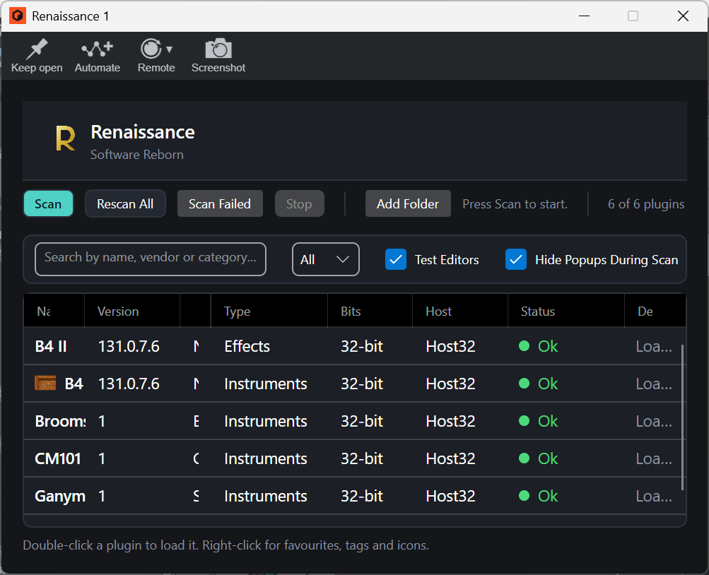
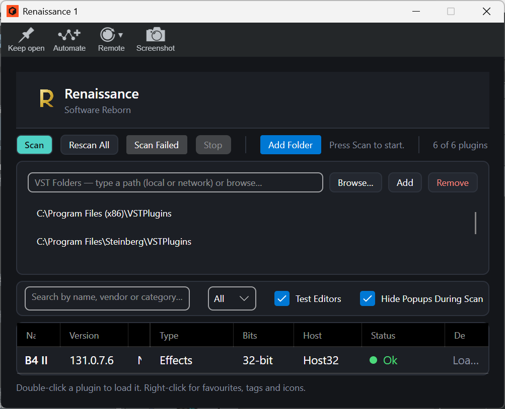
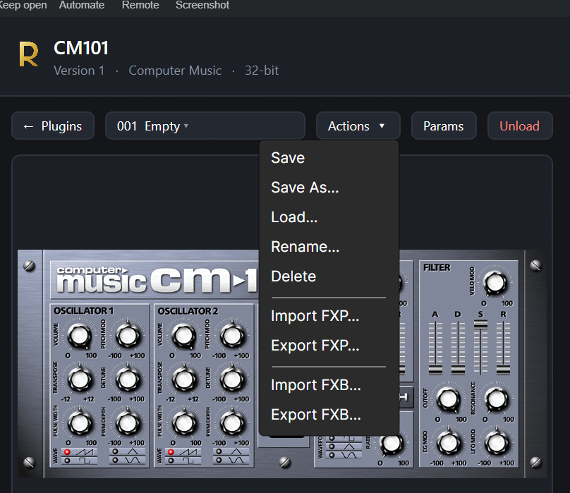
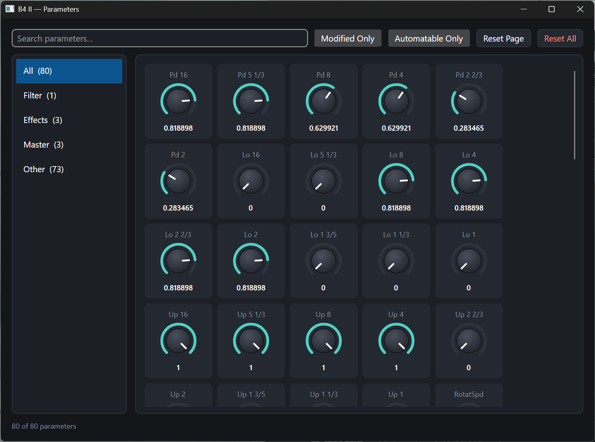
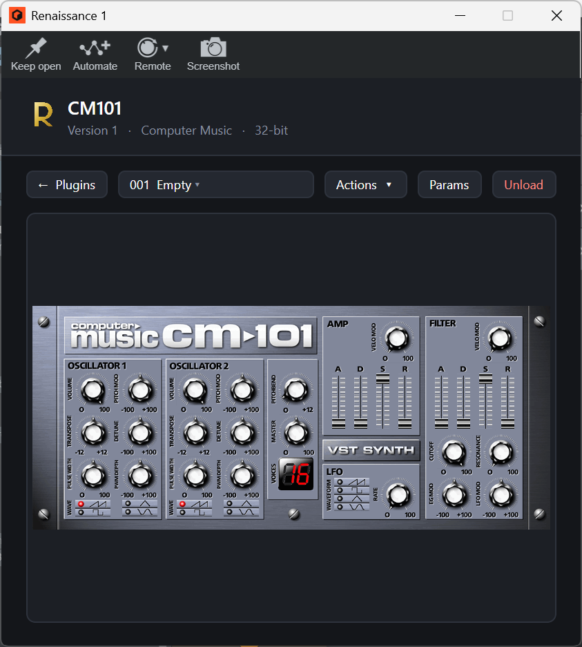

# Renaissance


> Universal VST2/VST3 legacy plugin bridge

Host legacy 32-bit and 64-bit VST2 plugins inside modern DAWs with:

- Crash isolation
- Modern preset management
- Generic parameter editor
- VST2 , VST3 and Clap wrappers
- Embedded Avalonia UI
- NativeAOT wrappers
- Automated plugin scanning


---

## Screenshot Gallery

> Replace these placeholder images as development progresses.

### Main Plugin Window



### Plugin Folder



### Save Patches



### Generic Parameter Editor



### Show the plugin

 


---

## Solution Layout

```text
src/
  Renaissance.Core
    Business logic:
      IPC
      Host client
      PluginSession
      Audio bridge
      WrapperLink

  Renaissance.PresetEngine
    FXP / FXB / .rpreset support
    Preset storage

  Renaissance.PluginDatabase
    SQLite database:
      Plugins
      ScanLocations
      PluginMetadata
      CrashHistory

  Renaissance.Scanner
    Plugin scanning via isolated hosts

  Renaissance.Host64
  Renaissance.Host32
    Isolated VST2 host processes

  Renaissance.Vst2
    NativeAOT VST2 wrapper

  Renaissance.Vst3
    NativeAOT VST3 wrapper

  Renaissance.UI
    Avalonia desktop application

tests/
  Renaissance.Tests

docs/
  UI-DESIGN.md
```

# Tested on

- Reason 10
- Reason 14
- Morning Daw